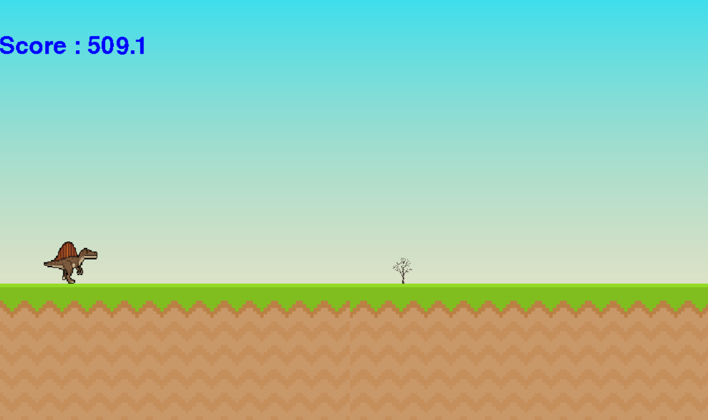

# Dino Game

A simple 2D dinosaur runner game built with Python and Pygame. Avoid incoming obstacles, survive as long as possible, and try to achieve a higher score.

## Gameplay



## Features

- Animated dinosaur player.
- Jump mechanics with gravity.
- Multiple obstacles, including trees and flying birds.
- Randomized obstacle spawning.
- Sprite-based collision detection.
- Score system based on survival time.
- Game Over screen.
- Restart functionality.

## Controls

| Key | Action |
|---|---|
| `SPACE` | Jump |
| `ENTER` | Restart after Game Over |

## Built With

- Python
- Pygame

## How to Run

1. Clone the repository.
2. Install Pygame:

   ```bash
   pip install pygame
   ```

3. Run the game:

   ```bash
   python main.py
   ```

## Project Status

Completed — core gameplay, scoring, collision detection, and restart functionality are implemented.

